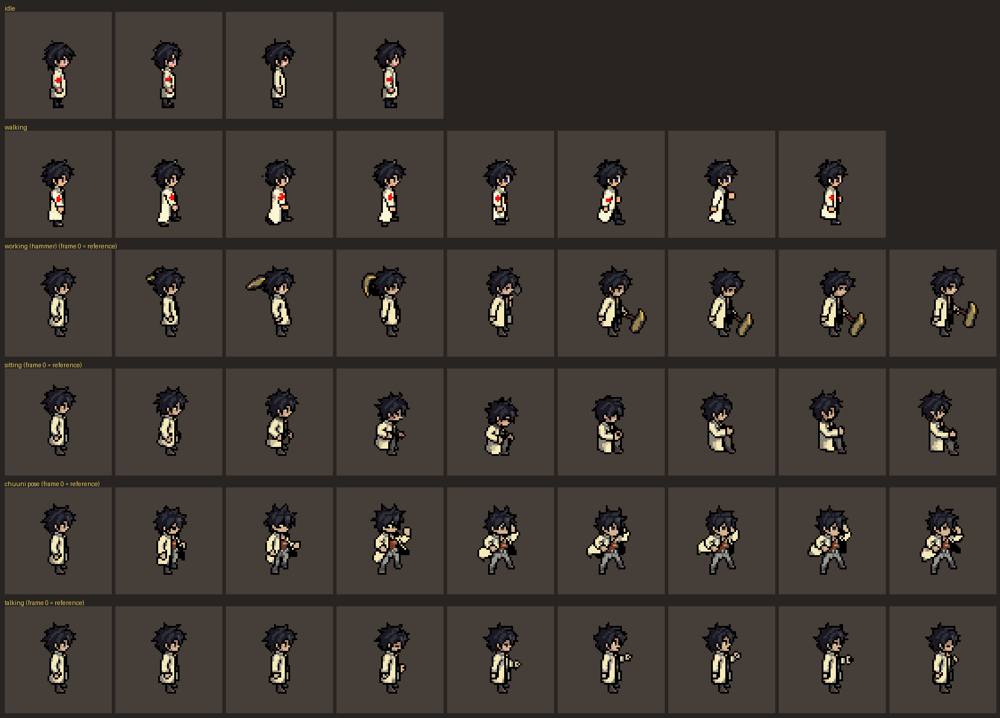
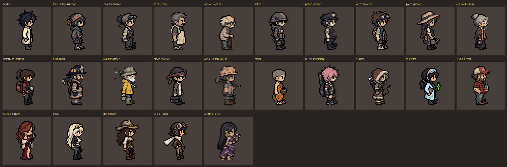
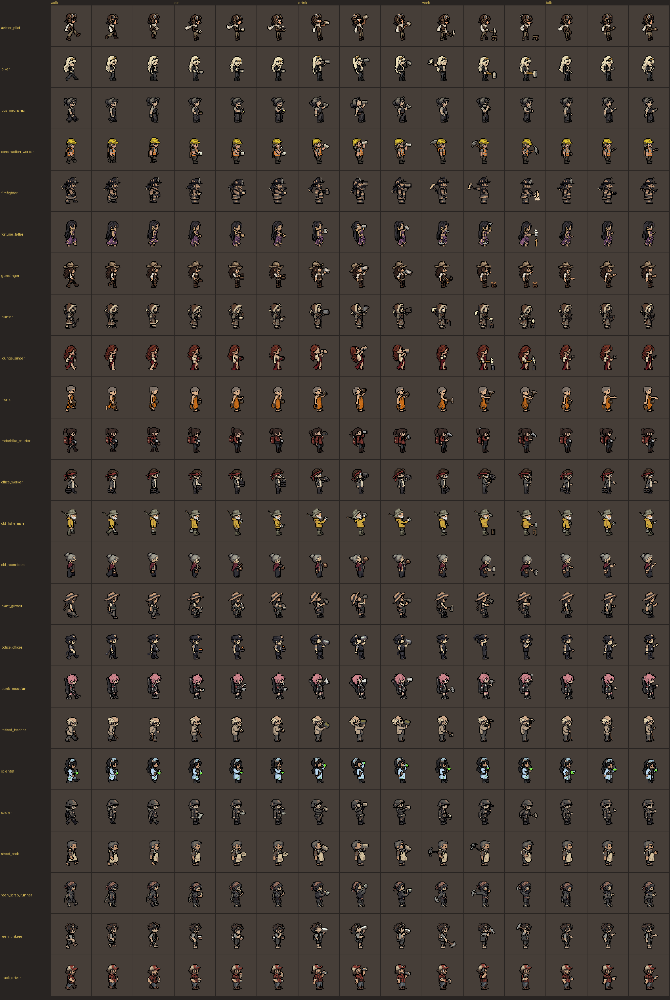
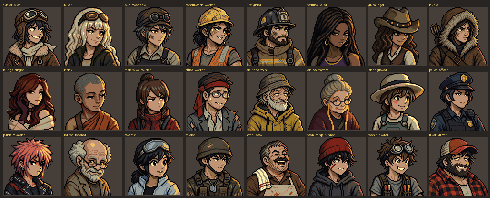

# Approved reference for crew art and animation

Parames approved this chibi field medic on 2026-10-29 as the reference for the art style
and the animation of every future crew character. The approved files are in
[`crew-style-reference/approved/`](crew-style-reference/approved/), the PixelLab ids,
prompts and file hashes in
[`crew-style-reference/manifest.json`](crew-style-reference/manifest.json).

## Scope

This sets the look and the motion of crew. It does **not** yet change the game: the in-game
crew are still the 14x20 `dw_*` strips and rooms are still 64x52
([room style reference](room-style-reference.md)). The medic is about twice that resolution
(a 20x40 figure on a 48x48 canvas) and was reviewed on 128x104 room drafts
([`previews/in-rooms.png`](crew-style-reference/previews/in-rooms.png)). Moving the game to
this scale (crew sprites, `Atlas.DW_W/DW_H`, rooms, room ambience positions, combat and
expedition views) is a separate decision and ticket. Until then, new crew art made for the
current game keeps the `dw_*` contract, and art made ahead for the new scale follows this file.

## Art contract

- **Chibi proportions:** about 2.3 heads tall, the head roughly 40 % of the figure. On the
  48x48 canvas the side-view figure is about 20x40 px with the feet on row 42. Silhouette and
  hair shape must read at 1x.
- **2D side view.** Draw and animate the right-facing (east) view; left is a horizontal
  mirror. Front and back views exist on the PixelLab character but are not used.
- **Style:** single-colour soot-black outline, basic shading with 2-3 tones per material,
  muted and desaturated clothes (bone, grey, dull olive, rust), one accent per character
  (the medic's red cross). No antialiasing, gradients, glow or semi-transparent pixels: alpha
  is 0 or 255 only.
- **Palette:** PixelLab's character mode does not keep the master palette (the raw medic has
  204 colours, 23 of them in it). Every production frame is snapped to
  `tools/art/common.py` `PALETTE` with `tools/art/pixelize.py` `nearest()`. The snap keeps
  the look ([`previews/palette-snap-check.png`](crew-style-reference/previews/palette-snap-check.png),
  raw on top, snapped below); skin goes slightly greyer.
- **Fits the rooms:** checked against medical #5, hydroponics #2 and kitchen #1 of the HD
  room drafts, which match its light and tone.

## Animation contract

East only, nearest sampling, integer scale. The custom (v3) clips are on a 60x60 canvas with
frame 0 equal to the standing reference; template clips are 48x48. Align every clip on the
feet, not on the canvas.

| Clip | Frames | fps | Playback | Notes |
|---|---|---|---|---|
| `idle` | 4 | 5 | loop | template `breathing-idle`; coat slightly whiter and slimmer than the reference (template drift) |
| `walk` | 8 | 10 | loop | template `walking-8-frames`; same drift as idle |
| `work` | 9 | 9 | loop | hammer strike in front; the wind-up swings behind the head |
| `sit` | 9 | 7 | one-shot, hold last | no seat drawn: place on a chair, bed or crate in the room |
| `chuuni_pose` | 9 | 8 | one-shot, hold last | coat flip, hand over one eye |
| `talk` | 9 | 7 | loop | small nods and a hand gesture |
| `eat` | 9 | 7 | loop | bowl and spoon |
| `drink` | 9 | 6 | one-shot | canteen; not a loop |
| `exercise` | 9 | 8 | loop | squats; the coat flares back more than it should |
| `activity_guitar` | 9 | 8 | loop | the relaxation activity |
| `stressed` | 9 | 9 | loop | hunched, clutching the head |

New clips for this or another character use PixelLab `animate_character` in `v3` mode, east
only, with a short motion-only `action_description` (1 generation each at this size). Prefer
v3 over templates: the v3 clips keep the reference look, the templates drift.

## Approved cast designs

Twenty-four more crew were designed from the medic and approved on 2026-10-29 as designs only
(no character rotations or animations yet). Files in
[`approved/cast/`](crew-style-reference/approved/cast/), prompts and post-processing in the
manifest `cast`. All stand on row 42 like the medic.

In the HD rooms: [`previews/cast-in-rooms.png`](crew-style-reference/previews/cast-in-rooms.png).

| File | Who |
|---|---|
| `teen_scrap_runner.png` | Teenage girl, scrap runner: red bandana, patched hoodie, slingshot |
| `bus_mechanic.png` | Middle-aged woman, bus mechanic: headscarf, goggles, overalls, tool belt |
| `street_cook.png` | Middle-aged man, former street food cook: moustache, apron, towel on the shoulder |
| `retired_teacher.png` | Old man, retired teacher turned radio operator: glasses, cardigan, cane |
| `soldier.png` | Young man, soldier: dented helmet, camouflage fatigues, tactical vest, slung rifle |
| `police_officer.png` | Middle-aged woman, police officer: police cap with badge, vest, baton and radio |
| `teen_tinkerer.png` | Teenage boy, electronics tinkerer: magnifying goggles, tool vest, coiled wires |
| `plant_grower.png` | Young woman, plant grower: straw hat, braid, green apron, watering can |
| `old_seamstress.png` | Old woman, seamstress: grey bun, glasses on a chain, maroon shawl, sewing bag |
| `motorbike_courier.png` | Young woman, motorbike courier: red leather jacket, helmet under the arm |
| `firefighter.png` | Middle-aged man, firefighter: turnout coat, helmet, axe |
| `old_fisherman.png` | Old man, fisherman: bucket hat, yellow rain jacket, rod and bucket |
| `office_worker.png` | Middle-aged man, ex office worker: torn suit, necktie headband, briefcase |
| `construction_worker.png` | Middle-aged woman, construction worker: hard hat, hi-vis vest, sledgehammer |
| `monk.png` | Young man, Thai Buddhist monk: saffron robe, prayer beads, alms bowl |
| `punk_musician.png` | Teenage girl, punk musician: pink spiky hair, studded jacket, guitar case |
| `hunter.png` | Middle-aged woman, hunter: fur-lined parka, bow and quiver |
| `scientist.png` | Young woman, scientist: light-blue lab coat, goggles, glowing test tube |
| `truck_driver.png` | Middle-aged man, truck driver: red cap, red-and-black flannel, thermos |
| `lounge_singer.png` | Adult woman, lounge singer: auburn waves, red evening gown, long gloves, microphone |
| `biker.png` | Adult woman, biker: platinum-blonde hair, cropped leather jacket, tight jeans |
| `gunslinger.png` | Adult woman, gunslinger: cowboy hat, leather corset vest, hip revolver |
| `aviator_pilot.png` | Adult woman, aviator: black bob, flying cap and goggles, bomber jacket, white scarf |
| `fortune_teller.png` | Adult woman, fortune teller and dancer: long black hair, gold jewellery, violet skirt, tarot cards |

Notes:

- Palette correction made the hoodie and headscarf greyer than asked, and the soldier and
  police officer are dark overall (they can sink into dark rooms). The six with a strong
  accent colour (courier, fisherman, monk, punk, scientist, truck driver) were made without
  palette correction. In a master-palette snap the punk's pink turns salmon and the
  scientist's light blue turns cream: the palette has no pink or light blue.
- **Back foot:** the medic stands slightly angled and shows its back foot. Sixteen of the
  designs only showed one leg, so their bottom leg rows were copied 3 px right and 1 px up,
  darkened and put behind the figure (manifest `cast.postprocess`). The cook, teacher and
  firefighter already showed both feet; the lounge singer and fortune teller wear
  floor-length skirts. Check this on every new design.
- The five glamorous women were made without palette correction; the fortune teller's
  violet has few matches in the master palette.
- The punk musician's legs came out 2 px long; two shin rows were removed.

If they are animated, keep these designs as they are and add accents only through a new
approved edit.

## Cast animations

All 24 cast designs are PixelLab characters (ids in the manifest `cast_animations`) with seven
east clips each: `walk`, `eat`, `drink` (one-shot), `work` (hammer), `talk`, `idle` (5 frames)
and a personal `signature` move that fits the character (one-shot; per-character prompt in the
manifest, e.g. the hunter draws her bow, the monk gives a wai). Clips have 9 frames with frame 0
as the reference pose; left-facing is a mirror of each clip. Files in
[`approved/cast_animations/<name>/<clip>/`](crew-style-reference/approved/cast_animations/),
plus each character's `east.png`.

The characters were rebuilt from the designs, so their side view can differ slightly from
`approved/cast/` (the construction worker gained a clearer hard hat and vest). Use the
animation frames together; do not mix them with the design PNG. In `work`, some characters
gained a small anvil or bench at their feet (pilot, gunslinger, hunter, lounge singer,
fortune teller) and a few wind up behind the head.

## Cast portraits

Every cast character has a 64x64 bust portrait in
[`approved/portraits/`](crew-style-reference/approved/portraits/): three-quarter view facing
right, an expression that fits the character, snapped to the master palette so it keeps the
game's muted tone. Recipe in the manifest `cast_portraits`.

Portraits must share one cartoon style and head size: the punk musician, courier, monk and
teen scrap runner are the style references. Make a new portrait by editing the teen scrap
runner portrait into the new person (manifest `cast_portraits.restyled_from_reference`); the
truck driver, firefighter, fisherman, tinkerer, cook, pilot, soldier, police officer, hunter, construction worker and office worker were redone that way after drifting
towards a realistic look with smaller heads.

## Making a new crew character

1. **Design** (5 generations per draft): `edit_image_pro_flash`, `method` text, `image` =
   `approved/rotations/east.png`, `no_background` true, `use_color_palette_correction` true.
   Prompt: `Turn this character into a different person while keeping exactly the same art
   style, pixel size, outline, shading, muted colours, chibi proportions, side-view pose and
   canvas: <age, job, hair, clothes, one prop>`. Editing the medic keeps its build, outline
   and tones; `create_image_pixflux` with the medic only as an init image (1 generation) keeps
   the pose but drifts to a cleaner, more saturated generic chibi, so it is not used. Palette
   correction pulls everything towards the medic's greys: ask for one clear accent colour.
2. **Review** beside the medic at the same integer scale and inside the HD rooms; Parames picks.
   Check the figure height (about 36-41 px, no long legs), feet on row 42 and the back foot.
3. **Character** (about 10 generations): `create_character` mode `pro`, `concept_image_url` =
   the approved draft, size 48.
4. **Animations** (1 generation per clip): `animate_character` v3, `directions: ["east"]`,
   the clips above.
5. Snap to the master palette, save the approved files and a manifest entry beside this one.

PixelLab spends Parames's generations: show the count and get an OK before each batch
(CLAUDE.md hard rules).
