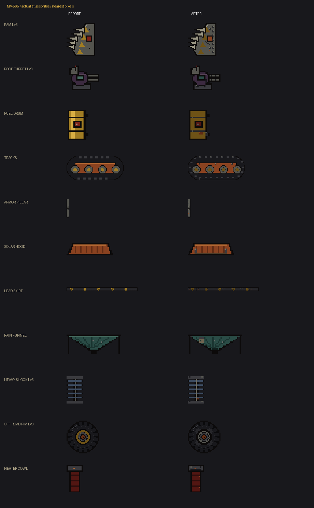
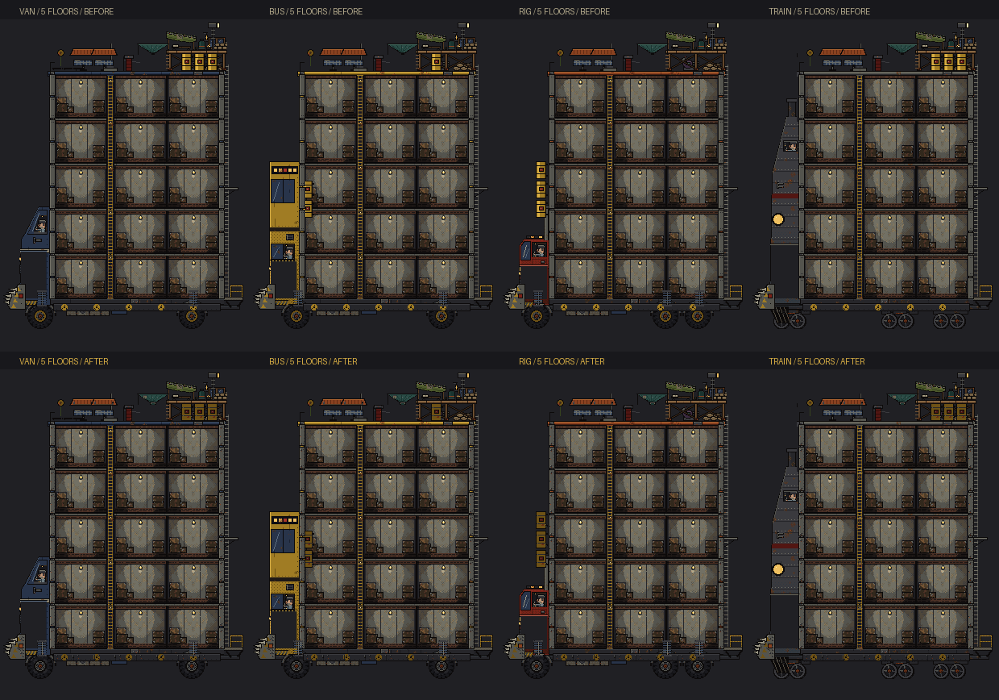
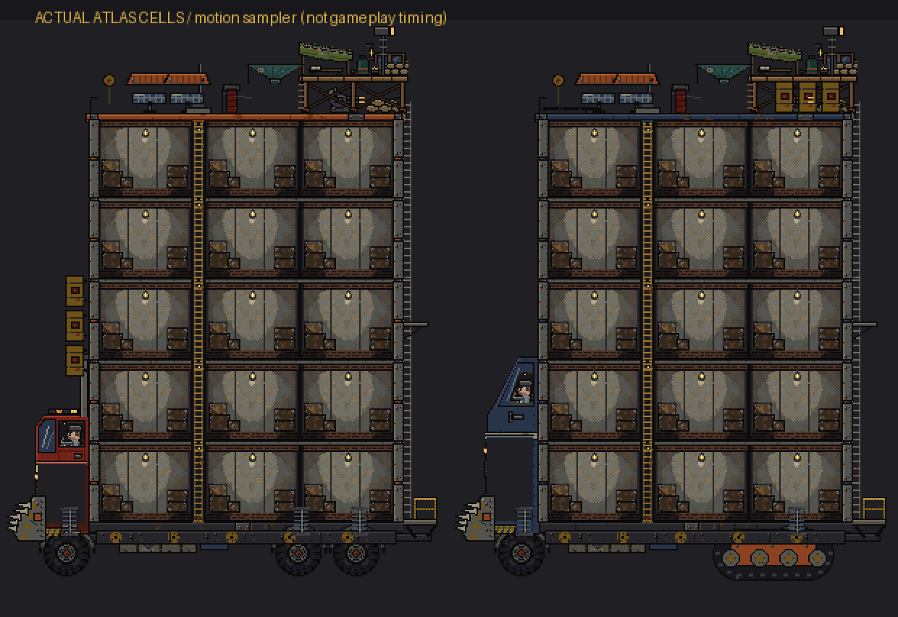

# Exterior mod detail and motion — MV-565

Parames approved one epic and implementation by Codex on 2026-10-28. The forty
contracts are in `tools/art/exterior_mods/contracts.json`; their 110 native atlas
cells cover every exterior mod plus the visible chimney of the interior heater.
There are no new costs, mechanics, save fields or changes to combat, fuel, water,
weight or weather calculations.

`tools/art/exterior_mods.py` runs after the original truck and drivetrain generators.
It preserves sprite dimensions and silhouettes, adds small material clusters, and
emits strips with exact contract palettes and binary alpha. Steel, olive, muted
hazard paint, soot and sparse rust share `common.py`'s master palette; only muzzle
flashes, existing braziers and lookout lamps use luminous amber.

## Current-source amendments

The review draft was based on an older local checkout. The branch also integrates
MV-563's five-floor growth and fuel-drum placement from current staging. Muzzle and
runoff anchors follow their actual mod sprites, including the lifted next-floor
preview, instead of assuming a four-floor roof. Implementation uses current
staging and preserves the already approved cozy roof (MV-462 / MV-466..475), solar
poses (MV-461), wheel tread (MV-390), and driving cabs / shell hardware.

- The actual cozy awning fabric occupies 38x13 pixels. Its Lv1 strip replaces that
  crop at deck-local (0,12); support pixels and ties stay fixed. Lv2/3 keep their
  corrugated cap and net unchanged and use their brazier / lamp motion instead.
- Cleaned `ext_base_mod_roof_deck_*` / `ext_base_mod_heater` support sprites remove
  only the animated windows while the feature is on. Patch cells replace those
  windows without ghosting the old flame, cap or cloth. Original static textures
  return when motion is disabled.
- The new source module is the generator for all contracts, so artwork remains
  centralized and the original generators remain reusable. Track placement retains
  its existing three-pixel canvas overhang below the 300px vehicle shell.
- First-fit shelf packing reuses earlier row gaps, retaining staging's 64px height rounding and keeping the combined five-floor atlas at
  2048x2752, below staging's 2048x2816 budget. Atlas JSON continues
  to resolve every region; no consumer assumes texture coordinates.

## Playback and applicability

`ExteriorModMotion`, owned by `Vehicle`, uses cached atlas textures, one controller
and twelve preallocated transient sprites for the entire convoy. At most one
instance of each transient effect exists. Combat can reclaim an ambient slot at
the cap. Rebuild/uninstall releases old bindings and rim patches, reuses the pool
and resets cosmetic timers. No timer or node is created per shot or frame.

`exterior_mod_ambience` gates new motion and FX. Turning it off restores static
textures and removes rim overlays and the new Lv1 armor cue; rain Lv2's collar
and the skirt's purchased clamp density remain static level details. Tunables:
`mods.fps` (phase speed multiplier), `mods.gap` (delay multiplier), `mods.fx_cap`
(maximum active transients, hard cap twelve).

- Ram contact comes only from the real road-zombie collision branch; roof recoil
  and muzzle flash come only from the roof-shot rendering hook. Neither deals
  damage. Incoming hull-shot coordinates must intersect an actual installed plate
  before its chip effect is accepted.
- Off-road Lv2/3 rims follow their wheel's existing frame, including the parked
  frame. Tread and rim never use independent clocks. Road trailers inherit existing
  off-road equipment; tracks hide rear lead wheels. Train and wagons keep rail
  wheels, with no road suspension, track kit, rim overlays or dry contact grit.
- Ambient cloth, tabs, tie-downs and shocks move in short, staggered cycles.
  Parked mechanics hold their rest cell; wind can disturb cloth/cowls/latches.
  Existing deck braziers have a bounded repeating flame and Lv3's lamp varies only
  in brightness. No extra crew, vehicle or camera shake is introduced.
- Dry contact grit replaces overlapping stock dust for equipped road mods. Wet
  and snowy weather retains existing mud behavior. Runoff requires normal rain or
  storm and is layered behind the receiving tank; acid rain never collects water
  visually. The existing rear-roof drip uses a separate site and remains intact.
- Tree pause stops processing. Application suspension, hidden owners and offscreen
  sprites retain phase, with no catch-up jump. All sprites inherit the current body
  or wheel transform; roof displacement is applied once.

## Verification and previews

```
python tools/generate_pixel_art.py --atlas-only
python tools/verify_exterior_mods.py --preview build/exterior-mods
godot --path . --rendering-driver opengl3 -- --autotest --only=exterior_mods --out=<absolute directory>
```

The Python verifier checks sizes, palettes, alpha and transparent transient tails.
With pre-change `before.png` / `before.json` in the preview folder it also compares
every unrelated original sprite pixel-for-pixel. It creates `before-after.png`,
`all-vehicles.png` and `motion-preview.gif` from actual atlas cells. The GIF is a
motion sampler, not the randomized gameplay timing or a runtime screenshot.
The Godot test covers all chassis, 0–2 trailers, all levels, both hull views,
rim/track precedence, weather gates, bounded pools, pixel anchors, offscreen and
suspended playback, uninstall, feature-off restoration, and unchanged save data.

GOD MODE → รถ has motion on/off, cloth/tie-down cycle, roof shot, ram contact,
dry grit and rain-runoff preview buttons. A mod must be installed; runoff needs
rain/storm. Existing all-mods / no-mods and chassis/trailer buttons build the cases.

## Actual-atlas image previews

These are source-coordinate composites, rather than screenshots of gameplay timing.






