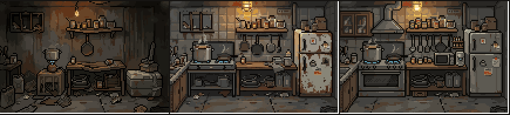
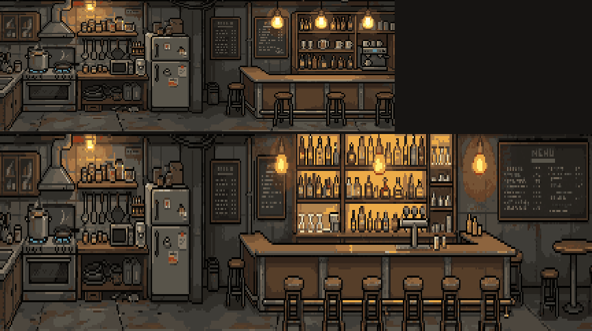
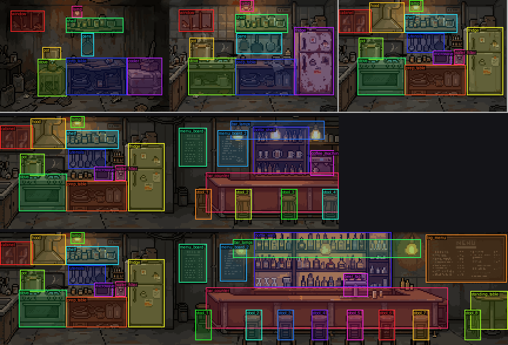
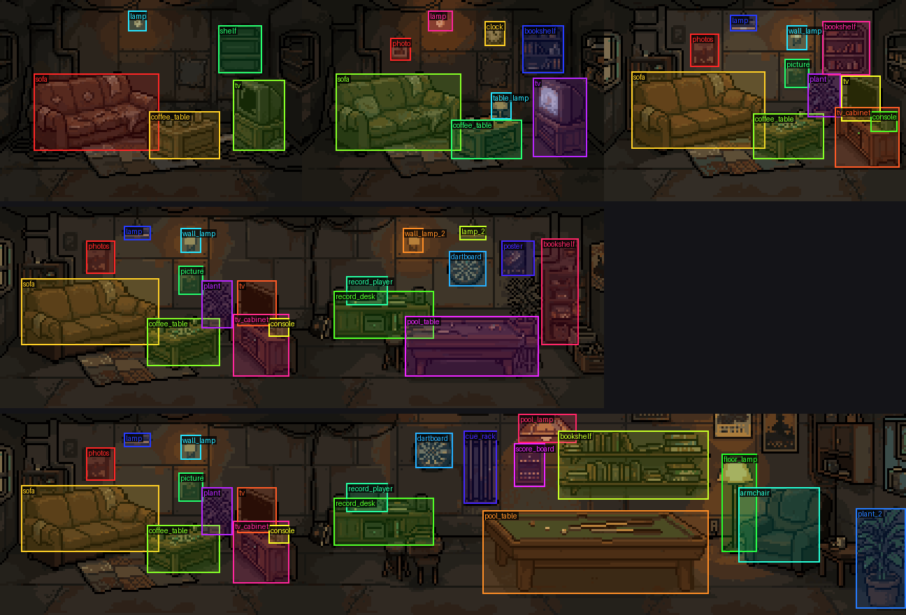
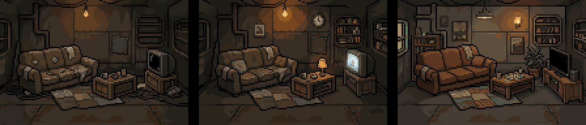
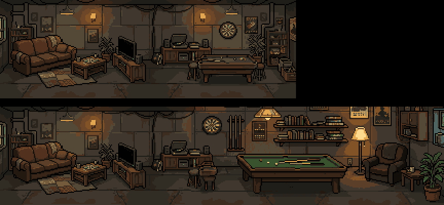
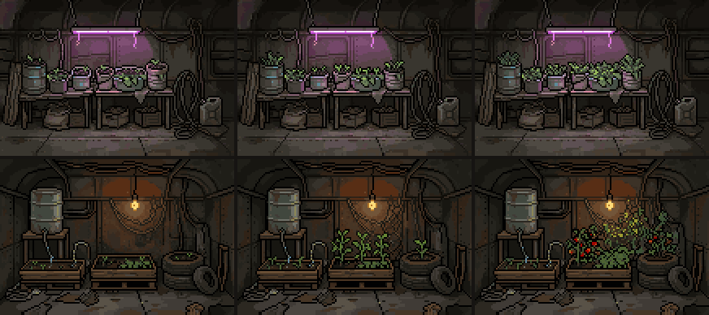
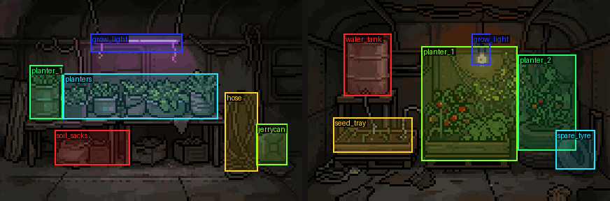
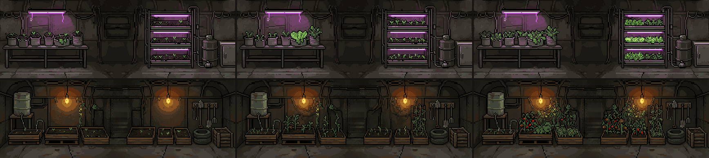
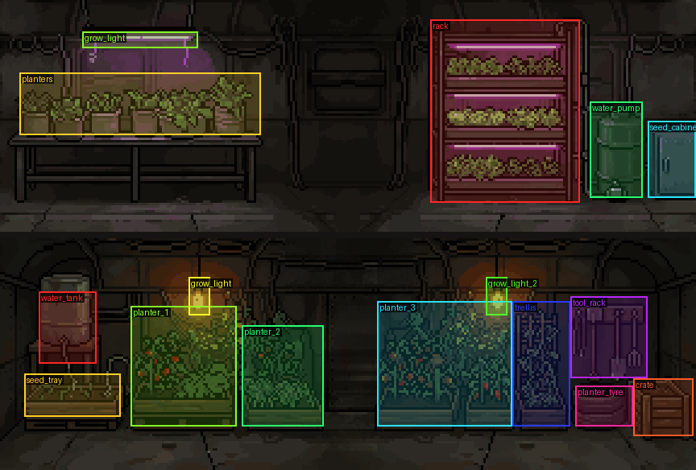

# Room style reference v2 (new crew scale)

Parames approved the mess kitchen as the reference for every future room on 2026-10-29
(MV-593, MV-595). It was drawn for the new crew characters in the
[crew style reference](crew-style-reference.md), which are about 38 px tall. The old
[64x52 room reference](room-style-reference.md) still describes the art that is in the game
today. Putting v2 rooms in the game needs the larger room size below, so it is a separate
decision (see MV-595).

Preview with animations: https://claude.ai/artifact/SpjgTwP7hzkvF64zc3Hcww




## Art contract

- **144x96 native pixels per room slot**, three slots per floor. Merged rooms are 288x96 (2 slots)
  and 432x96 (3 slots), one continuous room with no dividing wall or pillar.
- **Camera:** front view of a room cross-section, slightly above eye level, so the floor is a
  visible deep plane of floor plates that recedes to the back wall. Every room uses this same
  camera. No flat side-scroller floor strip, no isometric view.
- **Crew feet on y≈90** in a single room. Leave an open walkway along the front of the floor across
  the whole width, so crew walk on the floor in front of the furniture and never look like they
  float over it. Merged rooms put feet on y=94 in front of stools and tables.
- Dark post-apocalyptic, muted desaturated colours, crisp dark outlines, warm lamp light as the
  saturated accent. Nearest filter, binary alpha.
- People, pets, light, steam and other moving things are not baked into the background; they are
  drawn on top (see Animation states).

## Room levels

Each room has three levels, and the art must change visibly at every level:

| Level | Kitchen example | Rule |
|---|---|---|
| 1 | camp burner on a crate, cooler box, one crooked shelf, trash on the floor | makeshift, scavenged, poor |
| 2 | two-burner stove, old fridge, tiled wall, fuller shelves | a working room, still worn |
| 3 | cooking range with oven and hood, microwave, water filter, clean fridge, tidy shelves | **cleaner and more equipment** |

All three levels keep the same layout (L1 and L3 are edits of L2), so object anchors move little.

## Merged rooms

- Rooms can only merge at **level 3**, so merged art always looks upgraded and clean.
- A 2-slot merge keeps the L3 room on the left and adds a second purpose on the right
  (kitchen: a clean bar counter with stools, bottle shelves, coffee machine, menu board).
- A 3-slot merge keeps what the 2-slot room had, moved over and made bigger and better
  (kitchen: a longer bar with six stools, beer tap, lit bottle wall, big menu, standing table).

## Animation states

Every room has three states, drawn in code on top of the background:

- **Empty (idle):** lamp glow with a slow pulse and rare flicker, dust motes in the lamp light,
  plus room-specific micro animation (kitchen: steam from the pot, one low gas flame,
  L3 device LEDs).
- **Working:** crew at the room's work spot using their `work` clip, others walking the aisle;
  stronger effects (kitchen: every burner lit, more steam).
- **Power out:** room darkened to ~30 % with a blue tint, a slow red emergency light in the top-left
  corner, the lamp flickering back on now and then, only self-powered light left
  (kitchen: the gas flame).

The preview implementation and the anchor coordinates of every kitchen image are in
`room-style-reference-v2/tools/anim.py` (`ROOMS`).

## Tap hotspots (MV-599)

A PixelLab room is one flat image, so the game cannot know where the TV or the stove is.
Every room image therefore ships a **hotspot list**: one rectangle per object a player can tap.
Approved by Parames on 2026-10-29 (option 1: hotspots on the existing art, no extra generations).




Data lives next to the art, one file per room: `room-style-reference-v2/<room>/hotspots.json`.

```json
"L3": {"file": "kitchen_L3.png", "size": [144, 96], "hotspots": [
  {"id": "stove", "label": "Cooking range with oven", "rect": [16, 49, 41, 32],
   "kind": "station", "action": "open_cook_menu"},
  {"id": "microwave", "label": "Microwave", "rect": [80, 43, 16, 12],
   "kind": "device", "action": "use_device", "needs_power": true}
]}
```

- `rect` is `[x, y, w, h]` in native pixels of that image, origin top-left. Merged rooms use the
  coordinates of the whole 288x96 or 432x96 image. The rect covers the object's art; the game may
  pad the touch area (aim for at least ~44 screen px) but never shrinks it.
- `id` is stable across levels: the stove is `stove` at L1, L2 and L3 even when it changes from a
  camp burner to a cooking range, so game logic keys on the id, not on the level. Repeated objects
  are numbered (`stool_1`, `stool_2`, `wall_lamp_2`).
- **Later entries win where rects overlap**, so list big furniture first and the small thing on it
  after (TV cabinet, then TV, then console).
- `kind` is one of `station` (where crew work), `storage`, `device`, `screen`, `seat`, `game`,
  `light`, `info`, `decor`. `action` is a suggested handler name: `open_cook_menu`, `open_bar_menu`,
  `open_storage`, `use_device`, `watch_tv`, `play_game`, `play_music`, `play_pool`, `play_darts`,
  `read_book`, `water_plant`, `sit`, `toggle_light`, `show_info`, `inspect`. Add a new one to
  `tools/hotspots.py` when a room needs it.
- `needs_power: true` marks objects that stop working at power-out (lamps, fridge, TV, microwave);
  tapping them in the dark should say so instead of opening the action.
- `label` is English display text for now; the game will look it up through its own translations.

Rules for new rooms:

1. Every new v2 room image (each level and each merged size) ships its hotspots in the same
   commit as the art. A room without hotspots is not finished.
2. Mark every object a player would expect to tap: the room's work station(s), storage, devices,
   screens, seats, games and lights. Background clutter (trash, single bottles) is not needed.
3. Run `python tools/hotspots.py check` (ids unique, rects inside the image, known kind and action)
   and `python tools/hotspots.py overlay out` and look at the overlay PNGs before committing;
   add the overlay to the room's preview image in this doc.
4. If an object later needs its own look (broken stove, lit/unlit sign, opening fridge), cut it out
   as a separate sprite at the same rect and inpaint the background behind it. Do that only for
   objects that really change, since it costs PixelLab generations.

Wiring in Godot is not done yet, because the game still draws 64x52 rooms. When v2 rooms go in,
the room node reads the JSON for its level and merge size, scales each rect by the room's draw scale,
offsets it by the room's position, and routes taps through the same touch path as the rest of the
room UI.

## How the kitchen was made (PixelLab)

Sources are in `room-style-reference-v2/kitchen/`; the scripts in `tools/` are the exact ones used
(they read and write a scratch `out/` folder).

1. **L2 base:** `POST /v2/generate-image-v2`, `image_size` 144x96 (returns 4 candidates),
   `style_image` = the approved medic idle frame 0 (64x64, transparent),
   `style_options.color_palette` false, seed 7. Prompt in `gen.py` + camera text in `gen_deep.py`.
2. **L1 / L3:** `POST /v2/edit-images-v2` (`edit_with_text`) on the L2 image (`edit.py`), so the
   layout stays.
3. **2-slot merge:** L3 + its mirror on a 288x96 canvas, then `edit-images-v2` with the bar prompt.
4. **3-slot merge:** `POST /v2/inpaint-v3` on a 432x96 canvas: left 200 px of the 2-slot room kept,
   x 186-431 masked and redrawn as the bigger bar (`inpaint3.py`).
   Do not use `edit-images-v2` above ~300 px wide: it zooms in and crops the scene.

Cost on the subscription: about 10 generations per `generate-image-v2` call and 10-15 per edit or
inpaint call.

| File | SHA-256 (first 16) |
|---|---|
| kitchen/kitchen_L1.png | 87762585af5d979e |
| kitchen/kitchen_L2.png | fa092d12b974f521 |
| kitchen/kitchen_L3.png | 7820237e2221babf |
| kitchen/kitchen_L3_x2.png | e98d7050343d5fff |
| kitchen/kitchen_L3_x3.png | d1621d4495b3b696 |

## Second reference: living room (MV-597)

Parames approved a living room made to the same contract on 2026-10-29. Use it as the starting
point for rooms people rest or hang out in (living quarters, lounge, recreation or common rooms),
the same way the kitchen is the starting point for work rooms.




| Level | Living room | |
|---|---|---|
| 1 | torn sofa patched with tape, crate coffee table, broken CRT TV on a crate, bare bulb, scrap rug | makeshift |
| 2 | repaired sofa with cushions, wooden coffee table with a table lamp, working CRT TV on a stand, clock, framed photo, small bookshelf | cosier, still worn |
| 3 | clean leather sofa, flat-screen TV on a cabinet with a game console (green LED), wall lamp, plant, full bookshelf | clean, more equipment |
| L3 x2 | L3 living room on the left, game corner on the right: pool table, record player, dartboard, second bookshelf | second purpose |
| L3 x3 | the game corner made bigger: large pool table under a hanging lamp, cue rack, score board, long shelf of books and board games, reading armchair with floor lamp at the far right | bigger and better |

Rules this room added:

- **Screens are animated.** A TV or monitor that is on shows a moving picture: a few colour
  "channels" with a moving shape or scrolling lines, scanlines, a short burst of static on each
  channel change (about every 3 s), and a cold blue glow on the room. In the living room the
  flat-screen TV (L3, x2, x3) is on in the empty and working states and **goes dark when the power
  is out**. `anim_lv.py`: `screen_mask()` finds the screen (dark pixels connected to a seed point,
  eroded 2 px so the bezel stays) and `tv_frame()` draws the picture.
- The working state shows two crew walking the front strip; the power-out state shows one crew
  idle in the dark.

How it was made (all scripts in `room-style-reference-v2/tools/`):

1. **L1:** `generate-image-v2` 144x96, seed 7, `style_image` = the approved **kitchen L1**
   (144x96) with `style_options.color_palette` true (`gen_living.py`, option A). Using an approved
   room as the style image keeps the camera, floor and palette closer than the medic frame did.
2. **L2 / L3:** `edit-images-v2` on L1 (`edit_lv.py`), seed 1, so the sofa, table and TV stay put.
3. **L3 x2:** L3 + mirror on 288x96, `edit-images-v2`, seed 2 (`merge_lv.py m2`). Seed 1 left a
   pillar in the middle and was rejected.
4. **L3 x3:** `inpaint-v3` on 432x96 from the x2 room, mask x 186-431, seed 1 (`merge_lv.py m3`).
5. PixelLab outputs end with a white bottom row (y=95); the scripts copy row 94 over it.

Cost: 30 generations for the 12 L1 candidates (3 calls), about 109 for L2, L3, x2 and x3.
Anchors for every image are in `anim_lv.py` (`ROOMS`).

| File | SHA-256 (first 16) |
|---|---|
| living/living_L1.png | 7a346a4b44722f05 |
| living/living_L2.png | b774d5561d163aeb |
| living/living_L3.png | f95da710fce68dde |
| living/living_L3_x2.png | 99828d8caccd5a0a |
| living/living_L3_x3.png | 136834e9e8300ec8 |

## Third reference: grow room, level 1 (MV-598)

Parames kept **two** grow room designs at level 1, one slot (144x96), on 2026-10-29, then asked for the
merged 2-slot size of both (below). L2, L3 single and 3-slot are not made yet. Use these as the reference for plant, farm and greenhouse rooms, and
for any room whose contents change over time.



Rows: **A** `grow_a/` (LED grow rack: cut barrels and pots on a table under a purple LED strip) and
**B** `grow_b/` (pallet planters, stacked tyres, rain barrel with drip hoses, warm bare bulb).
Columns: stage 1 just planted, stage 2 half grown, stage 3 fully grown (`grow_<k>_L1.png`).

- **Growth stages are part of the art contract for growing rooms.** Each stage is a full image with the
  same layout: stage 3 is the generated room; stages 1 and 2 are `POST /v2/inpaint-v3` with the mask
  covering only the plant area and the result pasted back through the same mask, so walls, pots and
  furniture stay pixel-identical and the game can swap stages without anything else moving
  (`tools/stages_grow.py`, masks in `MASK`). About 5-10 generations per stage image.
- Each room has a signature light colour (A purple LED, B warm bulb) used for its glow layer.
- Animation (`tools/anim_grow.py`): idle / working (plant grower at the planters + one walker) /
  power-out as in the kitchen, plus leaves brightening slowly under the grow light, spores drifting in
  the light, water dripping from B's barrel hose, and a growth loop where a stage change plays a short
  green sparkle over the plant area. The sparkle is the cue the game should play when a crop advances.
- B's back wall first came out as bus windows with plastic sheeting; Parames asked for the same closed
  riveted steel bus body as A, made with `edit-images-v2` on the original (`tools/edit_grow_wall.py`,
  seed 2). Keep every room's back wall reading as the inside of the vehicle.
- Hotspots: `grow_a/hotspots.json`, `grow_b/hotspots.json`, one entry per stage image with the same rects
  (planters are `station` + `water_plant`, the grow light needs power).



### Grow room merged 2 slots (level 3)

Rooms merge only at level 3, so the 2-slot grow rooms are already the upgraded, clean version.
Made the same way as the living room: stage-3 L1 + its mirror on a 288x96 canvas, then
`edit-images-v2` with a level-3 prompt (`tools/merge_grow.py`; A seed 1, B seed 2), then stages 1 and 2
with the plant-area inpaint (`tools/stages_grow.py`, keys `A_M2` / `B_M2`).

- **A** keeps the pot table under the purple LED bar on the left; the right half is a three-tier metal
  shelf rack, each tier with its own LED strip, plus a water tank with pump and a seed cabinet.
- **B** keeps the rain barrel and seedling box; the rest is raised wooden beds (tomatoes, peppers, herbs),
  a trellis planter, a tyre planter, a tool rack and a harvest crate under two warm bulbs. The steel rib
  the edit left in the middle was removed on Parames's request (merged rooms must read as one room):
  `inpaint-v3` on the gap between the beds only, then a per-row brightness ramp so the patch matches the
  lamp-lit wall on both sides (`tools/wall_grow_m2.py`); the same patch is pasted onto all three stages.




Sources: `tools/gen_grow.py` (generate-image-v2 with the kitchen L1 as `style_image`, seed 7; A = image 0,
B = image 1), then the scripts above. They read and write a scratch `out/` folder.

| File | SHA-256 (first 16) |
|---|---|
| `room-style-reference-v2/grow_a/grow_a_L1.png` | aba5f044d660ad0c |
| `room-style-reference-v2/grow_a/grow_a_L1_stage1.png` | 25d15061dd87b84b |
| `room-style-reference-v2/grow_a/grow_a_L1_stage2.png` | 1a3cffbd547092fc |
| `room-style-reference-v2/grow_b/grow_b_L1.png` | cefa8d98468ab0cc |
| `room-style-reference-v2/grow_b/grow_b_L1_stage1.png` | ddcefcf4f7f3e9d2 |
| `room-style-reference-v2/grow_b/grow_b_L1_stage2.png` | c7120677a7cb9574 |
| `room-style-reference-v2/grow_a/grow_a_L3_x2.png` | 9ddd1d837f762963 |
| `room-style-reference-v2/grow_a/grow_a_L3_x2_stage1.png` | 9e6ec27f18f1f1ab |
| `room-style-reference-v2/grow_a/grow_a_L3_x2_stage2.png` | 3f871cf8e8f45440 |
| `room-style-reference-v2/grow_b/grow_b_L3_x2.png` | 7fd728ff90aced95 |
| `room-style-reference-v2/grow_b/grow_b_L3_x2_stage1.png` | 6b40ab0f54afd81f |
| `room-style-reference-v2/grow_b/grow_b_L3_x2_stage2.png` | 488c968abe3a2f82 |
